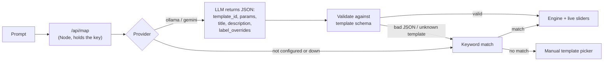
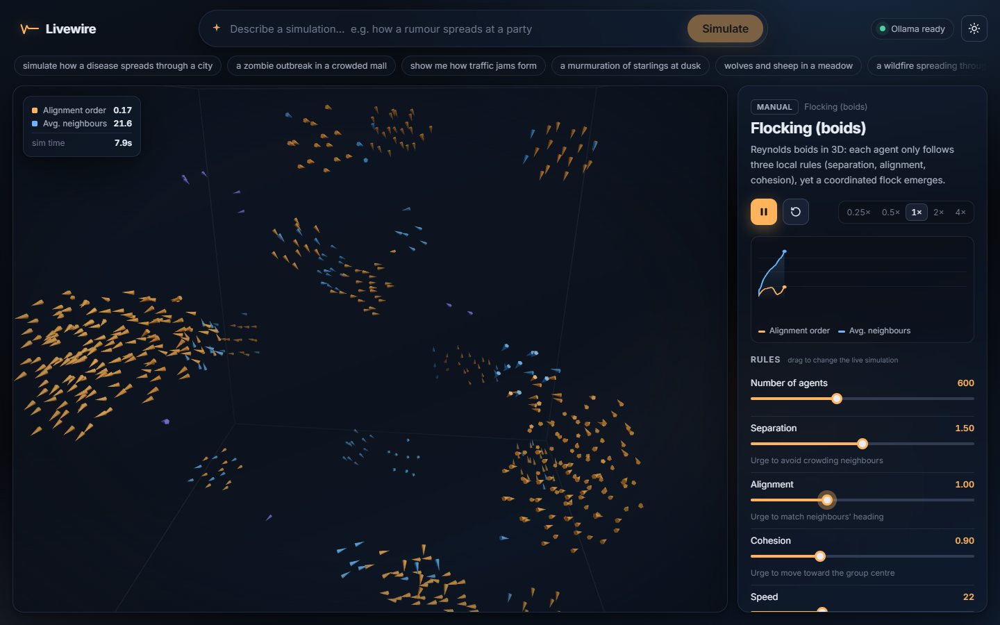

# Livewire

Type a prompt in plain English and get a **live, interactive simulation**. Drag sliders to change the rules and watch the system react in real time.


*Prompt: "a zombie outbreak in a crowded mall". The local model (llama3.2:3b via Ollama) picked the epidemic template, set 2,000 people with a high infection chance, and renamed "Infected" to "Zombies".*

## How it works: the AI configures, it never invents physics

Physics written by an LLM on the fly would be unreliable, so Livewire doesn't ask for it. The AI's only job is to **map** a prompt onto one of six hand-built simulation templates and **configure** it. It returns JSON, and that JSON is validated against the chosen template's parameter schema before anything runs.



- **Valid output** runs as-is. Out-of-range or junk values are clamped or reset to the default, and the panel lists every correction ("2 AI values corrected").
- **Invalid output** (prose, broken JSON, a template that doesn't exist, the provider timing out) falls back to the nearest template by keyword, and the panel says why.
- **No AI configured**: the app still works fully through keyword matching, the template library and the sliders. It shows "AI not configured" instead of pretending.
- The AI can also answer `"none"` for prompts that aren't a simulation, such as "bake me a cake". You then get the manual picker.

## The simulation library

| Template | View | Model | Live rules |
|---|---|---|---|
| Epidemic spread | Canvas 2D | Agent-based SIR with a spatial hash | population, infection radius, infection chance, recovery time, initial infected, movement speed |
| Flocking (boids) | Three.js | Reynolds boids in 3D (separation, alignment, cohesion) | agents, separation, alignment, cohesion, speed, vision radius |
| Predator–prey | Canvas 2D | Agent-based Lotka–Volterra: logistic prey growth, predators with an energy budget | prey birth rate, predation rate, predator death rate, starting populations |
| Traffic flow | Canvas 2D | Intelligent Driver Model on a ring road, plus a space-time trail of stopped cars | cars, road length, max speed, braking sensitivity, a "Trigger a slowdown" button |
| Gravity (n-body) | Three.js | Softened Newtonian gravity, O(n²), on a spinning disk | particle count, gravity strength, damping, initial spread, initial spin |
| Forest fire | Canvas 2D | Cellular automaton, 8 neighbours, wind-biased spread, optional regrowth | grid size, tree density, ignition points, spread probability, wind direction and strength, regrowth |

Each sim has its own live chart (S/I/R counts, prey and predators, average speed and jammed cars, and so on). Parameters marked **restarts** (for example grid size or road length) re-initialise the sim. Everything else changes the running simulation instantly, including agent counts, which grow or shrink in place.

| Traffic: jams form with no accident | Boids: a flock emerges from three local rules | Forest fire pushed by wind |
|---|---|---|
|  |  |  |

### Adding a 7th template

Drop one file in `src/sims/` that follows the contract documented at the top of [`src/sims/manifest.js`](src/sims/manifest.js): `params` schema, `init`, `step`, `stats`, and `render` (2D) or `render3d` (3D). Then add one import line to the manifest. The AI prompt, keyword fallback, sliders, chart, HUD and self-test all pick it up from there.

## Run it

Needs Node 18+.

```bash
npm install
npm run dev          # app + API on http://localhost:5173
```

Production:

```bash
npm run build
npm start            # serves dist/ + /api on http://localhost:8787
```

### Turning on the AI (free, two options)

```bash
cp .env.example .env
```

- **Local Ollama** (offline, no key): install [Ollama](https://ollama.com), run `ollama pull llama3.2:3b` (about 2 GB), and set `AI_PROVIDER=ollama`.
- **Gemini free tier**: set `AI_PROVIDER=gemini` and `GEMINI_API_KEY=` (key from Google AI Studio). Change `GEMINI_MODEL` if the default is retired.

Keys live only in `.env`, which is git-ignored, and are read only by the Node server. The browser never sees them. Leave `AI_PROVIDER` blank to run without AI.

**Keyboard:** `Space` play/pause · `R` reset · `/` focus the prompt.

## Self-test

```bash
npm run selftest
```

Runs with no network and no key. It checks that:

- every template inits, runs 300 ticks, renders, and stays finite with each parameter at its min and max
- sliders clamp to the schema, and `restart` params really restart
- each sim's dynamics actually happen: the epidemic spreads, phantom jams form, both species survive, dense forests burn more than sparse ones, the flock aligns, the gravity cloud stays bound
- the AI mapper, using a mock provider, routes 9 sample prompts to sensible templates with valid JSON
- invalid AI output (prose, truncated JSON, unknown template, wrong types, a network error, a `"none"` answer) falls back cleanly
- the HTTP API works

Latest run: **45/45 checks passed**. Excerpt:

```
PASS  traffic: jams form with no slowdown event  (up to 8 cars stopped in a jam within 120 sim-s)
PASS  forest fire: burns more at high density than low  (burnt share: density 0.3 -> 1%, 0.8 -> 99%)
PASS  boids: flock aligns over time  (alignment order 0.00 -> 0.51)
PASS  "a zombie outbreak in a crowded mall" -> epidemic  (labels {"I":"Zombies","S":"Humans"})
PASS  unknown template -> keyword fallback  (AI output rejected: unknown template_id "weather")
PASS  provider throws (network down) -> keyword fallback  (AI call failed: ECONNREFUSED)
All checks passed
```

## Performance

- Simulation frames never re-render React. Canvas 2D sims draw from a `requestAnimationFrame` loop, 3D sims update one `InstancedMesh` inside `useFrame`, and the HUD and chart write to the DOM or canvas directly a few times a second.
- Fixed-timestep engine: a 0.25×–4× speed control, and frame time is clamped so a slow frame drops time instead of spiralling.
- Paused while the tab is hidden.
- Agent, particle and cell counts are capped per device: 35–60% of the desktop maximum on phones and low-core machines.
- Three.js (about 840 kB) is lazy-loaded only when a 3D template runs. The main bundle is about 180 kB (62 kB gzipped).

## Limitations

- **Six templates, not "anything".** A prompt that doesn't resemble one of them gets the closest analogy or the picker. These are simplified teaching models, not calibrated forecasts.
- **Small local models are inconsistent.** In my testing, llama3.2:3b routed every demo prompt sensibly, but it sometimes kept default parameters, and it occasionally forced an off-topic prompt (for example "write my homework essay") into a template instead of answering `"none"`. A larger model should do better.
- **The Gemini path is written but untested here**, because I had no key during development. The Ollama path and the mock provider are tested.
- The keyword fallback only uses default parameters. It can't read "strong wind" into a slider value.
- Resizing the window mid-run lets 2D agents wrap into the new bounds instead of rescaling.
- n-body gravity is O(n²) and capped at 800 particles.

## Project layout

```
src/sims/        six templates + manifest (pure JS, no browser APIs outside render)
src/engine.js    fixed-step runner, live params, chart history, device caps
src/ai/mapper.js system prompt, JSON extraction, schema validation, keyword fallback
src/App.jsx, Stage.jsx, View3D.jsx, Panel.jsx, styles.css   UI
server/api.mjs   providers (Ollama, Gemini, mock) + /api handler, no dependencies
server/index.mjs production server
selftest.mjs     the self-test
```

MIT License.
