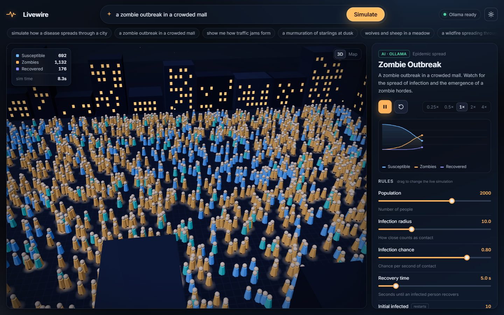
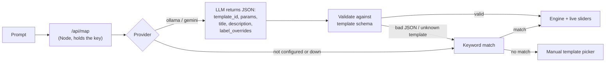
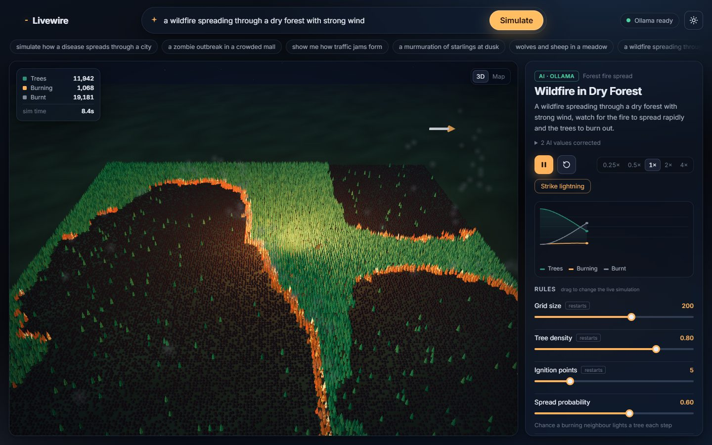
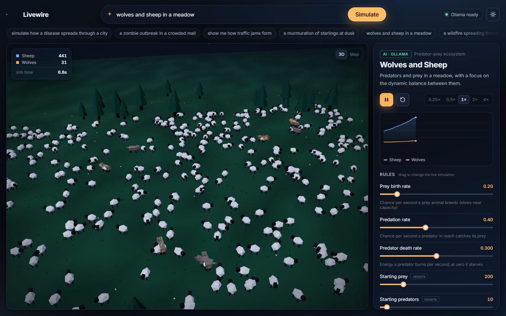
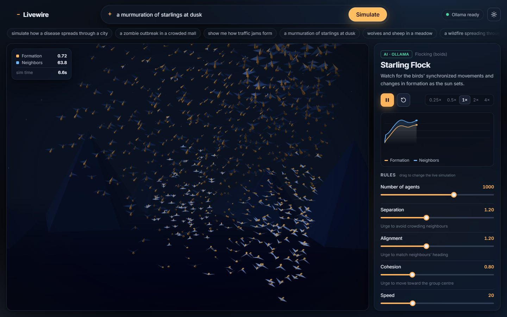
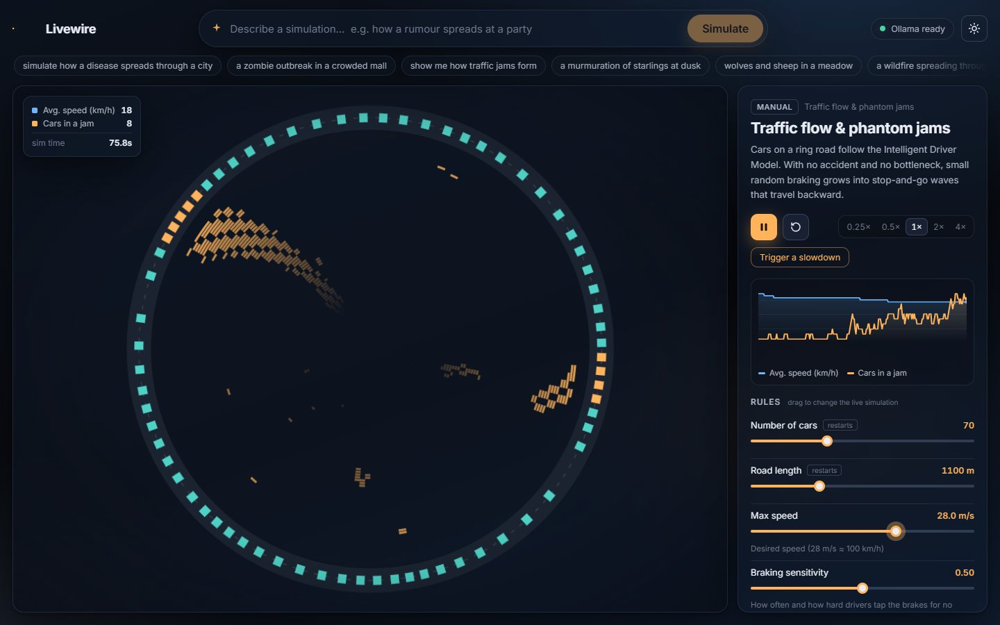
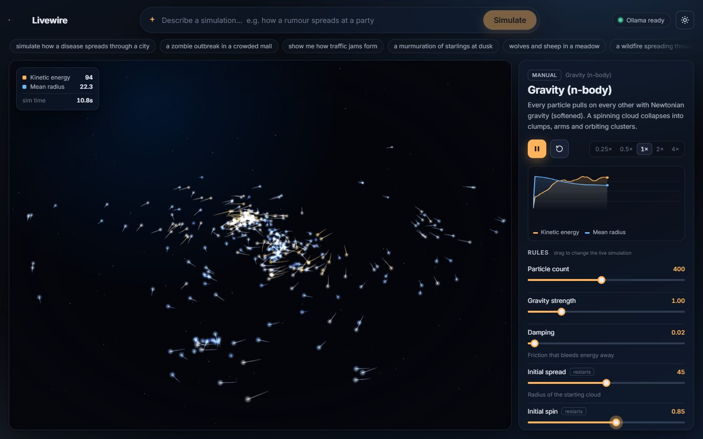

# Livewire

**In one line:** Livewire turns a plain-English sentence into a live simulation you can play with. A local AI either sets up one of seven built-in 3D simulations or writes a brand-new one when none fits.

Type a prompt in plain English and get a **live, interactive simulation**. Drag sliders to change the rules and watch the system react in real time.



*Prompt: "a zombie outbreak in a crowded mall". The local model (llama3.2:3b via Ollama) picked the epidemic template, set 2,000 people with a high infection chance, and renamed "Infected" to "Zombies".*

## How it works: the AI configures, it never invents physics

Physics written by an LLM on the fly would be unreliable, so Livewire doesn't ask for it. Normally the AI's job is to **map** a prompt onto one of seven hand-built simulation templates and **configure** it. When none of them fits, experimental mode (below) lets it write a new one. It returns JSON, and that JSON is validated against the chosen template's parameter schema before anything runs.



- **Valid output** runs as-is. Out-of-range or junk values are clamped or reset to the default, and the panel lists every correction ("2 AI values corrected").
- **Invalid output** (prose, broken JSON, a template that doesn't exist, the provider timing out) falls back to the nearest template by keyword, and the panel says why.
- **No AI configured**: the app still works fully through keyword matching, the template library and the sliders. It shows "AI not configured" instead of pretending.
- The AI can also answer `"none"` for prompts that aren't a simulation, such as "bake me a cake". You then get the manual picker.

## Experimental mode: the AI writes a new simulation

The library can't cover everything, so when no built-in simulation shows what you asked for (for example "ants carrying food back to their nest" or "people evacuating a stadium through two exits"), the AI writes a brand-new simulation in JavaScript on the spot:

1. The code streams onto the screen as the model writes it.
2. It calls a small drawing kit (`art.car`, `art.person`, `art.ant`, `art.tree`, `art.water`, `art.light`, ...), so objects look like what they are instead of dots.
3. It runs only inside a **sandboxed iframe**: opaque origin, no access to the app, and a Content-Security-Policy that blocks all network requests. A watchdog stops it if it freezes.
4. Before you see it, it runs in a hidden sandbox: `init`, 60 `step`s, a `draw`, and `stats`. If anything throws, the error goes back to the AI for one repair attempt. If that also fails, you get the closest built-in simulation and the reason.
5. Its sliders, chart, play/pause and speed controls work like the built-in ones. "Show the code the AI wrote" displays the source, and "Regenerate" asks again.

On a built-in result that isn't quite right, **"Not quite it? Build exactly this with AI"** switches to this mode.

Measured on my laptop with local `llama3.2:3b`: each generated simulation took 30–90 s to write and test (the first run also loads the model, about 20 s). Across 9 runs with 5 different prompts, 8 produced a working simulation, one of them only after its automatic repair. One failed both attempts (it called a drawing helper that didn't exist yet) and fell back cleanly. Unknown helper names are now harmless. Visual quality varies a lot: ants and the stadium crowd looked right, while "rain filling a lake" came out as abstract bars. The kit's built-in example is an ant colony, so ant prompts come out especially well. A bigger model (or Gemini) should do much better.

## The simulation library (7 built-in)

| Template | 3D scene | Model | Live rules |
|---|---|---|---|
| Epidemic spread | People walking a city plaza; infected glow amber, recovered turn teal | Agent-based SIR with a spatial hash | population, infection radius, infection chance, recovery time, initial infected, movement speed |
| Flocking (boids) | Birds with flapping wings over hills and a lake | Reynolds boids in 3D (separation, alignment, cohesion) | agents, separation, alignment, cohesion, speed, vision radius |
| Predator–prey | Sheep and wolves on a meadow; wolves flash after a catch | Agent-based Lotka–Volterra: logistic prey growth, predators with an energy budget | prey birth rate, predation rate, predator death rate, starting populations |
| Traffic-light intersection | City crossroads with working traffic lights, zebra crossings and queues | IDM cars on 4 approaches with a 6-phase signal cycle | traffic volume, main-road share, green time per road, speed limit, a "Break down a car" button |
| Traffic flow | Cars on a ring highway; brake lights glow in jams | Intelligent Driver Model on a ring road, plus a space-time trail of stopped cars | cars, road length, max speed, braking sensitivity, a "Trigger a slowdown" button |
| Gravity (n-body) | Glowing stars with motion trails, coloured by speed | Softened Newtonian gravity, O(n²), on a spinning disk | particle count, gravity strength, damping, initial spread, initial spin |
| Forest fire | Thousands of trees, flames, smoke drifting with the wind, charred stumps | Cellular automaton, 8 neighbours, wind-biased spread, optional regrowth | grid size, tree density, ignition points, spread probability, wind direction and strength, regrowth |

Each sim has its own live chart (S/I/R counts, prey and predators, average speed and jammed cars, and so on). Parameters marked **restarts** (for example grid size or road length) re-initialise the sim. Everything else changes the running simulation instantly, including agent counts, which grow or shrink in place.

All seven are low-poly 3D scenes built in code (no model downloads), rendered with React Three Fiber. You can orbit and zoom them. Dark mode shows them at night (lit windows, headlights, glowing flames); light mode shows them in daylight. The 2D sims also have a flat **Map** view (toggle at the top right of the stage), which is handy for reading patterns such as the traffic space-time trail.

| Wildfire pushed by wind | Sheep and wolves | Starling flock |
|---|---|---|
|  |  |  |
| **Phantom traffic jams** | **Galaxy forming** | |
|  |  | |

### Adding another template

Drop one file in `src/sims/` that follows the contract documented at the top of [`src/sims/manifest.js`](src/sims/manifest.js): `params` schema, `init`, `step`, `stats`, and `render` (2D) or `render3d` (3D). Then add one import line to the manifest. The AI prompt, keyword fallback, sliders, chart, HUD and self-test all pick it up from there, and it runs right away with that flat view. For a custom 3D scene, add `src/scenes/<id>.jsx`, which is picked up automatically.

## AI model used

| | |
|---|---|
| Model | **Llama 3.2 3B** (`llama3.2:3b`, by Meta), about 2 GB |
| Runs on | [Ollama](https://ollama.com), locally on your own computer: free, offline, no API key |
| Used for | 1) mapping a prompt to a built-in simulation (JSON output at temperature 0), and 2) writing new simulation code in experimental mode (streamed) |
| Tested on | a laptop with a Ryzen 5 5600H and 16 GB RAM: about 36 tokens/s, 15–20 s for a mapping, 30–90 s for a generated simulation |
| Optional | Gemini free tier (`AI_PROVIDER=gemini`). Supported in code but **not tested** (no key during development). |

I also tried `qwen2.5-coder:7b` for writing code. It was too slow on this laptop (about 6 tokens/s, because half of it ran on the CPU), so the project uses `llama3.2:3b` for both jobs. To try a different model for code only, set `CODE_MODEL` in `.env`.

## Run it: step by step

### 1. Install Node.js
Install Node.js 18 or newer from [nodejs.org](https://nodejs.org). Check it with:
```bash
node -v
```

### 2. Get the code and install packages
```bash
git clone https://github.com/Omkar210404/livewire.git
cd livewire
npm install
```

### 3. Install Ollama (the free local AI runner)
- **Windows:** download the installer from [ollama.com/download](https://ollama.com/download), run `OllamaSetup.exe`, and follow the steps.
- **macOS:** download the app from [ollama.com/download](https://ollama.com/download) and move it to Applications.
- **Linux:** `curl -fsSL https://ollama.com/install.sh | sh`

Check that it's installed:
```bash
ollama --version
```

### 4. Download the model (about 2 GB, one time)
```bash
ollama pull llama3.2:3b
ollama list            # llama3.2:3b should appear here
```

### 5. Make sure Ollama is running
On Windows and macOS it usually starts by itself after installing (look for the llama icon in the tray or menu bar). If it isn't running, start it in a separate terminal and leave that window open:
```bash
ollama serve
```
Opening http://127.0.0.1:11434 in a browser should show "Ollama is running".

### 6. Create your settings file
```bash
cp .env.example .env          # macOS / Linux / Git Bash
copy .env.example .env        # Windows Command Prompt / PowerShell
```
The defaults already use Ollama with `llama3.2:3b`, so you don't need to edit anything.

### 7. Start Livewire
```bash
npm run dev
```
Open **http://localhost:5173**. The pill at the top right should say **"Ollama ready"**. The first prompt takes about 20 s longer while the model loads into memory.

### 8. (Optional) Run the self-test
```bash
npm run selftest
```

### Troubleshooting
- **"Ollama not reachable"**: Ollama isn't running. Do step 5.
- **"model is not pulled"**: do step 4.
- **"AI not configured"**: `.env` is missing or `AI_PROVIDER` is blank. Do step 6. The app still works without AI: pick a simulation from the library and use the sliders.

### Production build
```bash
npm run build
npm start            # serves dist/ + /api on http://localhost:8787
```

### Using Gemini instead of Ollama (optional, untested)
In `.env`, set `AI_PROVIDER=gemini` and `GEMINI_API_KEY=<your key>` (a free key from Google AI Studio). Change `GEMINI_MODEL` if the default model is retired.

Keys live only in `.env`, which is git-ignored, and are read only by the Node server. The browser never sees them.

**Keyboard:** `Space` play/pause · `R` reset · `/` focus the prompt.

## Self-test

```bash
npm run selftest
```

Runs with no network and no key. It checks that:

- every template has a 3D scene, inits, runs 300 ticks, renders, and stays finite with each parameter at its min and max
- sliders clamp to the schema, and `restart` params really restart
- each sim's dynamics actually happen: the epidemic spreads, phantom jams form, both species survive, dense forests burn more than sparse ones, the flock aligns, the gravity cloud stays bound
- the AI mapper, using a mock provider, routes 9 sample prompts to sensible templates with valid JSON
- invalid AI output (prose, truncated JSON, unknown template, wrong types, a network error, a `"none"` answer) falls back cleanly
- the HTTP API works, including streamed code from `/api/generate`
- experimental mode: good generated code passes the sandbox check, broken code (prose, syntax errors, a missing function, a crash inside `step`) is rejected with a readable error, made-up drawing helpers don't crash, and the sandbox page blocks the network
- the intersection really reacts: badly timed lights build much longer queues

Latest run: **59/59 checks passed**. Excerpt:

```
PASS  traffic: jams form with no slowdown event  (up to 8 cars stopped in a jam within 120 sim-s)
PASS  forest fire: burns more at high density than low  (burnt share: density 0.3 -> 1%, 0.8 -> 99%)
PASS  boids: flock aligns over time  (alignment order 0.00 -> 0.51)
PASS  "a zombie outbreak in a crowded mall" -> epidemic  (labels {"I":"Zombies","S":"Humans"})
PASS  unknown template -> keyword fallback  (AI output rejected: unknown template_id "weather")
PASS  provider throws (network down) -> keyword fallback  (AI call failed: ECONNREFUSED)
All checks passed
```

## Performance

- Simulation frames never re-render React. Each 3D scene updates instanced meshes (one draw call per kind of object: people, cars, trees, flames) inside `useFrame`. The forest only touches trees whose state changed. The HUD and chart write to the DOM or canvas directly a few times a second.
- Fixed-timestep engine: a 0.25×–4× speed control, and frame time is clamped so a slow frame drops time instead of spiralling.
- Paused while the tab is hidden.
- Agent, particle and cell counts are capped per device: 35–60% of the desktop maximum on phones and low-core machines.
- Three.js (about 840 kB) and each scene (3–6 kB) are lazy-loaded. The main bundle is about 185 kB (63 kB gzipped).
- In headless Edge on my laptop, every scene ran at 70–145 fps with default settings.

## Limitations

- **Seven built-in templates.** Anything else goes through experimental mode, which is hit-or-miss with a small local model (see above). The built-in ones are simplified teaching models, not calibrated forecasts.
- **The sandbox is a strong barrier, not a guarantee.** The generated code can't reach the app or the network, but a page-freezing loop in the same browser process can still hang the tab until it is closed.
- **Small local models are inconsistent.** In my testing, llama3.2:3b routed every demo prompt sensibly, but it sometimes kept default parameters, and it occasionally forced an off-topic prompt (for example "write my homework essay") into a template instead of answering `"none"`. A larger model should do better.
- **The Gemini path is written but untested here**, because I had no key during development. The Ollama path and the mock provider are tested.
- The keyword fallback only uses default parameters. It can't read "strong wind" into a slider value.
- The 2D worlds wrap around: people and animals that walk off one edge reappear on the other, so in the city they can seem to step out of a building. Agents also pass through each other; there is no collision.
- Resizing the window mid-run lets 2D agents wrap into the new bounds instead of rescaling.
- n-body gravity is O(n²) and capped at 800 particles.

## Project layout

```
src/sims/        seven templates + manifest (pure JS, no browser APIs outside render)
src/engine.js    fixed-step runner, live params, chart history, device caps
src/ai/mapper.js system prompt, JSON extraction, schema validation, keyword fallback
src/ai/customSim.js  experimental mode: code-writing prompt, drawing kit, checker, sandbox page
src/custom.js    browser side: streaming, hidden-sandbox test, engine wrapper
src/scenes/      one 3D scene per template + shared kit (lighting, low-poly model builder)
src/App.jsx, Stage.jsx, Panel.jsx, styles.css   UI (Stage picks the 3D scene or the flat Map view)
server/api.mjs   providers (Ollama, Gemini, mock) + /api handler, no dependencies
server/index.mjs production server
selftest.mjs     the self-test
```

MIT License.
